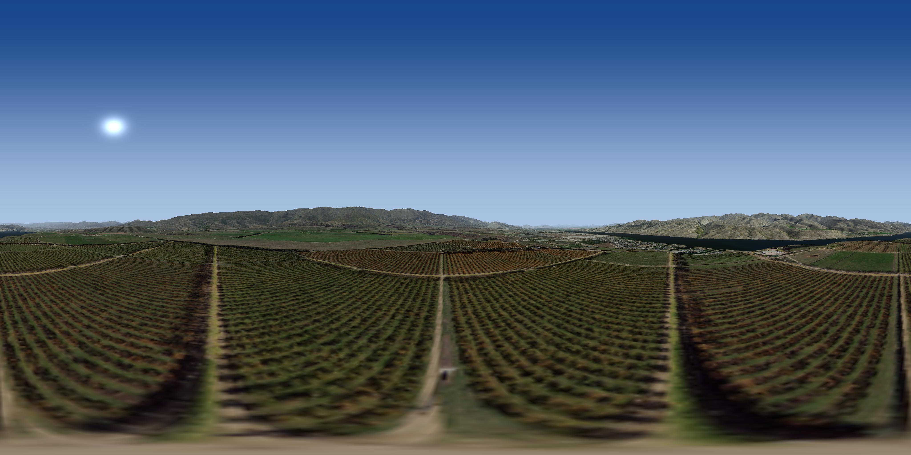
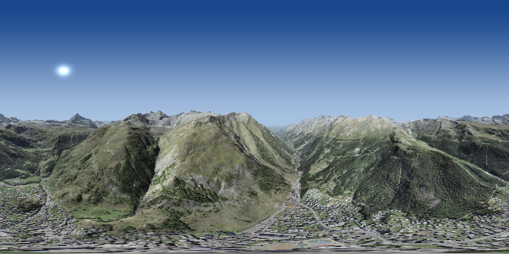
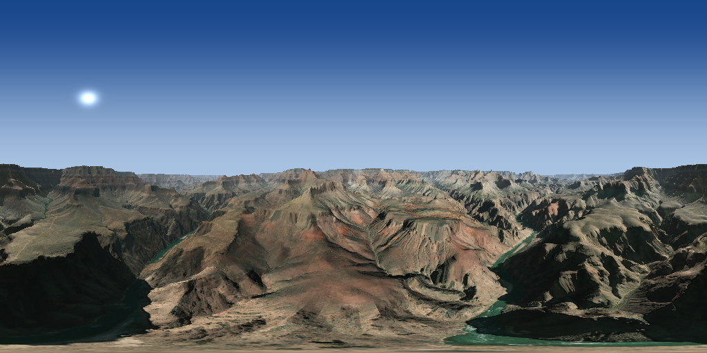
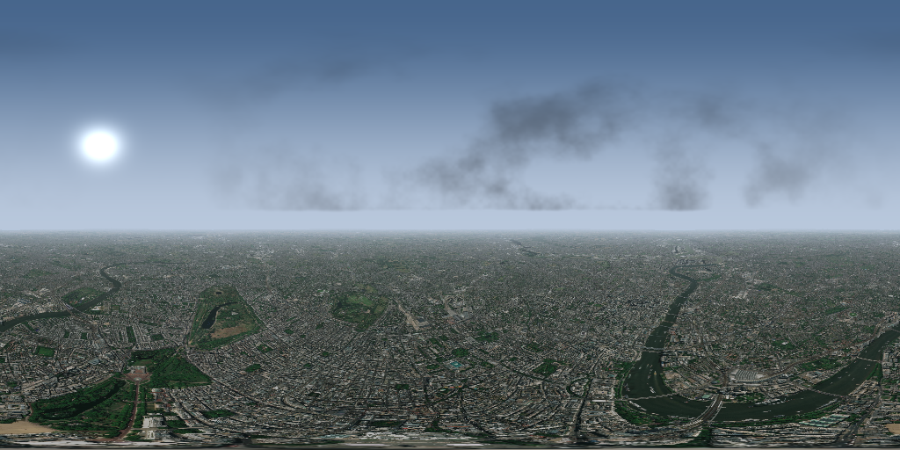

# Skybox Generator




Render a textured, terrain-accurate **equirectangular skybox** (2:1 panorama)
for any location on Earth, using **satellite imagery** for colour and **SRTM
elevation** for relief. The panorama is produced by ray-marching the local
heightfield, so hills and mountains actually rise and occlude the sky.

Everything is done with `numpy` + `Pillow` (standard-library networking). No
API keys required.


## Features

This tool was designed to allow for automatic skybox generation in for our 

## Features

- **Any latitude/longitude** (SRTM covers ±60°; outside that the terrain is
  flat sea level).
- **Real relief** — 1-arc-second (~30 m) SRTM heights textine the terrain.
- **Satellite colour** — Esri World Imagery tiles are sampled onto the terrain.
- **Procedural sky** with three presets: `clear`, `cloudy`, `evening`.
- **Equirectangular output** (e.g. 2048×1024), importable directly as an
  environment/skybox in Blender, Unity, Unreal, etc.

## Install

```bash
pip install -e .        # or: pip install numpy Pillow
```

## Usage

```bash
# The Matterhorn, clear blue sky
python -m skybox --lat 46.0216 --lon 7.7480 --sky clear -o matterhorn.png --lod-count 8 --eye-height 1000 --width 1024

# Grand Canyon, evening, from a 400 m overlook
python -m skybox --lat 36.0986 --lon -112.1160 --sky clear   --eye-height 400 -o canyon.png --lod-count 8 --eye-height 1000 --width 1024

# Overcast London
python -m skybox --lat 51.5074 --lon -0.1278 --sky cloudy -o london.png --eye-height 2000 --lod-count 8 --width 1024
```





If installed via `pip install -e .`, the `skybox` console script is available
too.

### Options

| Flag | Default | Meaning |
|---|---|---|
| `--lat`, `--lon` | 46.0216, 7.7480 | Centre of the skybox |
| `--sky` | `clear` | `clear` / `cloudy` / `evening` (aliases: `blue`, `day`, `sunset`, `dusk`, `overcast`) |
| `-o, --out` | `skybox.png` | Output PNG |
| `--width` | `2048` | Panorama width (height is `width/2`) |
| `--radius-km` | `60` | Terrain surround radius (half the box side) |
| `--terrain-res` | `1024` | Terrain grid samples per axis |
| `--eye-height` | `2` | Metres above the local ground |
| `--heading` | `0` | Panorama centre heading, degrees clockwise from north |
| `--sun-azimuth` | preset | Sun compass bearing (deg from north) |
| `--sun-elevation` | preset | Sun altitude (deg above horizon) |
| `--zoom` | auto | Imagery zoom override |
| `--cache` | `~/.cache/skybox` | Where tiles/height data are cached |
| `--seed` | — | Cloud RNG seed |
| `--n-steps` | `192` | Ray-march steps (log-spaced; bisection refines the final hit anyway) |
| `--visibility` | `radius/3` | Haze e-folding distance in metres (lower = hazier distant terrain) |
| `--ambient` | `0.4` | Terrain ambient light `0..1`; `0` = hard sun-facing/sun-away shading, `1` = no shading |
| `--lod-count` | `8` | Terrain LOD levels; each level halves the covered radius so sample density doubles |
| `--list-skies` | — | List available sky presets |

For a scenic panorama of a mountain range, raise `--eye-height` (e.g. 500–1500)
so you stand above the valley; for a grounded sense of "being there", keep it
near `2`.

## Data sources

- **Elevation** — NASA/NGA SRTM GL1 (30 m), served from the public
  [skadi](https://github.com/tilezen/joerd) S3 bucket. Void samples (water) are
  treated as sea level.
- **Imagery** — Esri World Imagery tiles (Copyright © Esri and contributors).
  Please review Esri's terms for your use case; tiles are cached locally to be
  polite to the service.

Both are cached in `~/.cache/skybox` (override with `--cache` or the
`SKYBOX_CACHE` environment variable).

## How it works

1. A square terrain grid is built in a local east/north frame around the
   centre, sized `--radius-km` on each side.
2. SRTM tiles covering the grid are downloaded and bilinearly sampled into a
   height field; Esri tiles are mosaicked and sampled into a matching RGB field.
3. For each equirectangular pixel a ray is cast from the camera. Ray-marching
   (fixed exponentially-spaced steps + bisection) finds the first heightfield
   intersection, then the satellite colour is sampled there and blended toward
   the sky colour with a distance-dependent atmospheric haze (close terrain
   stays crisp, distant terrain fades toward the horizon haze).
4. Rays that miss the terrain (sky) are filled by the procedural sky, so the
   horizon and haze transition smoothly.

## Limitations

- SRTM only reaches ±60° latitude; nearer the poles the ground is flat.
- The terrain is finite (the `--radius-km` box); beyond it, distance fog fades
  into the sky for a seamless horizon.
- At `--eye-height 2` the bottom of the panorama shows the immediate ground;
  use a higher eye height for a distant-horizon look.